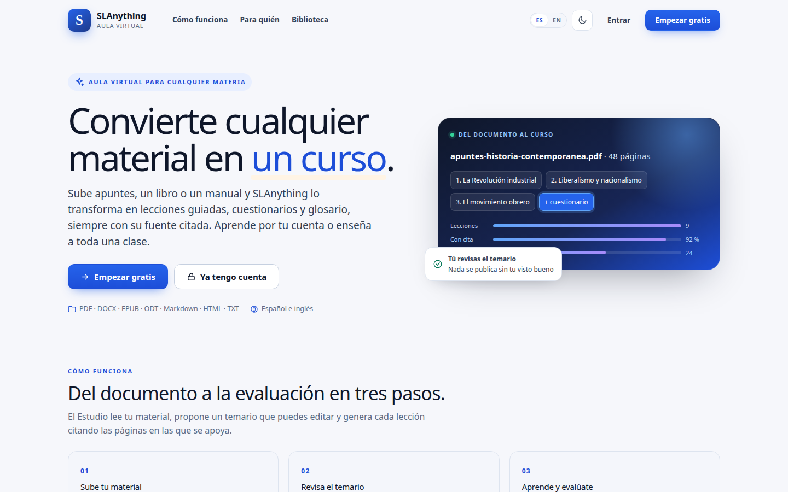
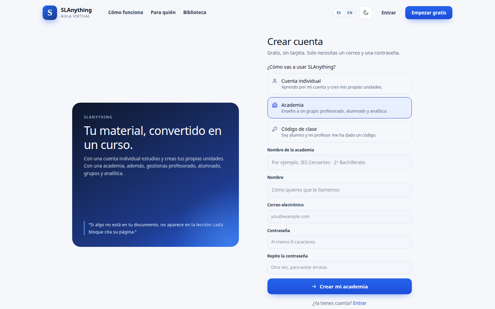
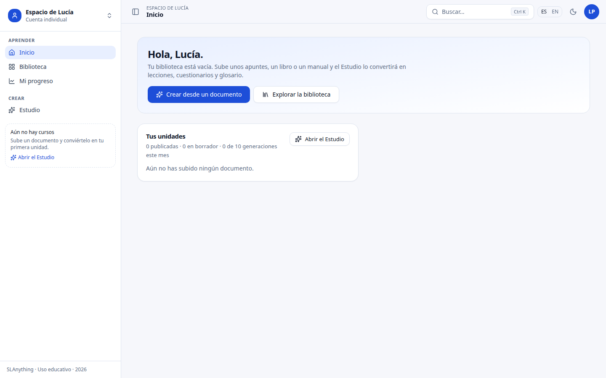
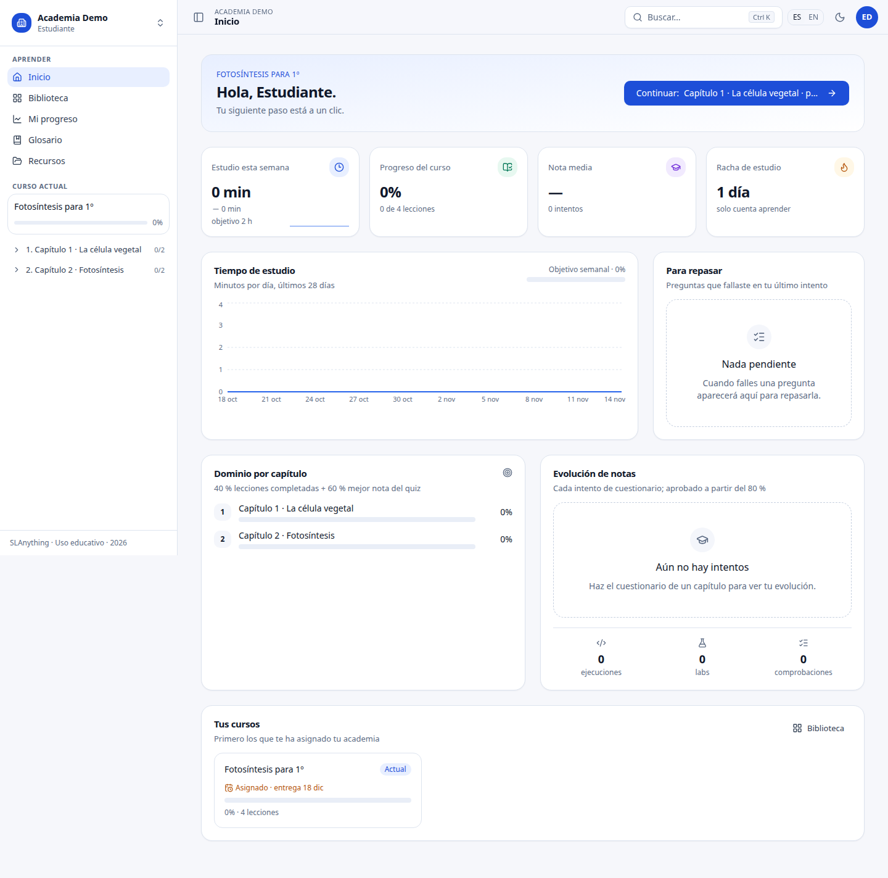
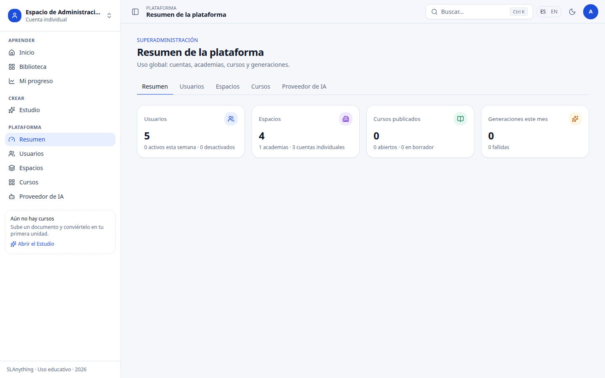
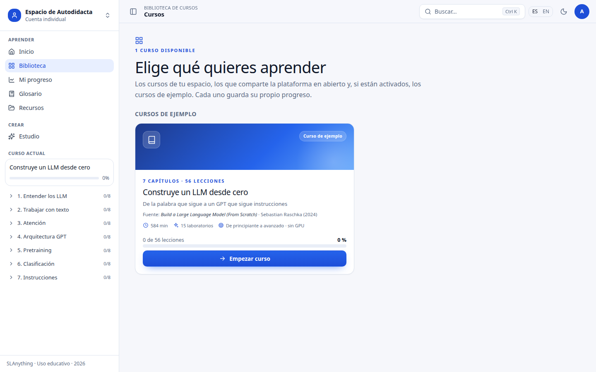
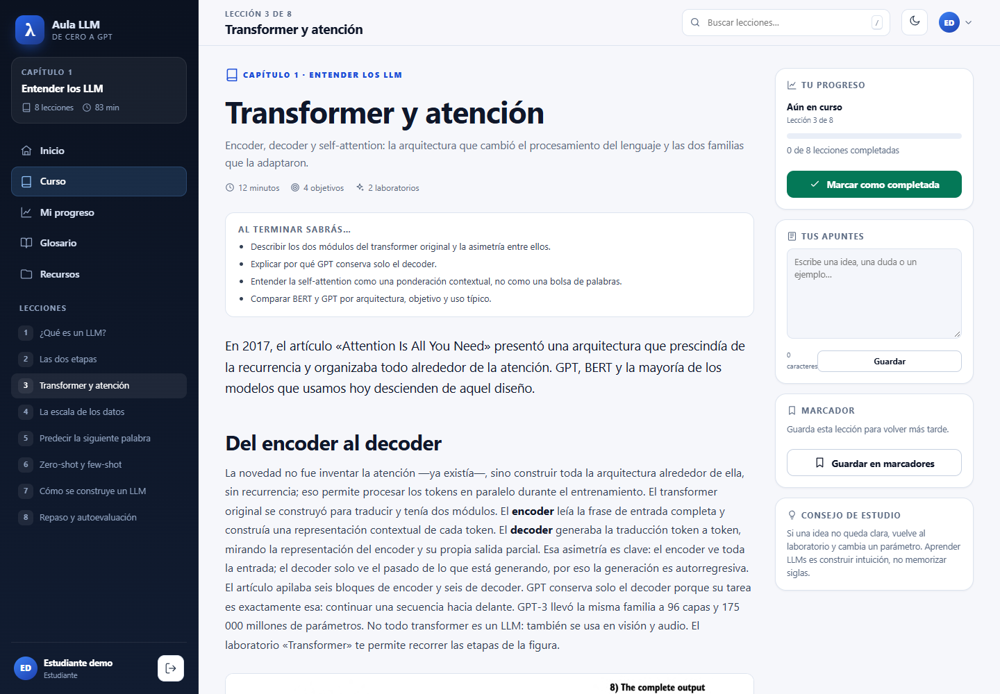
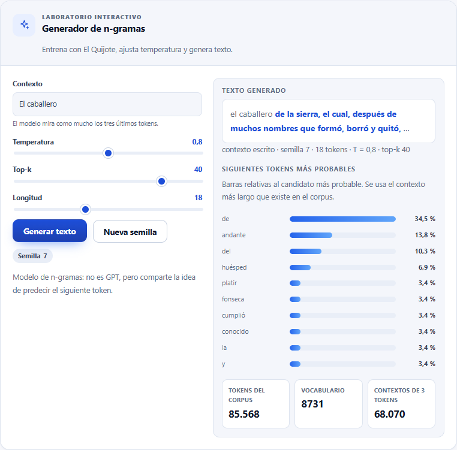
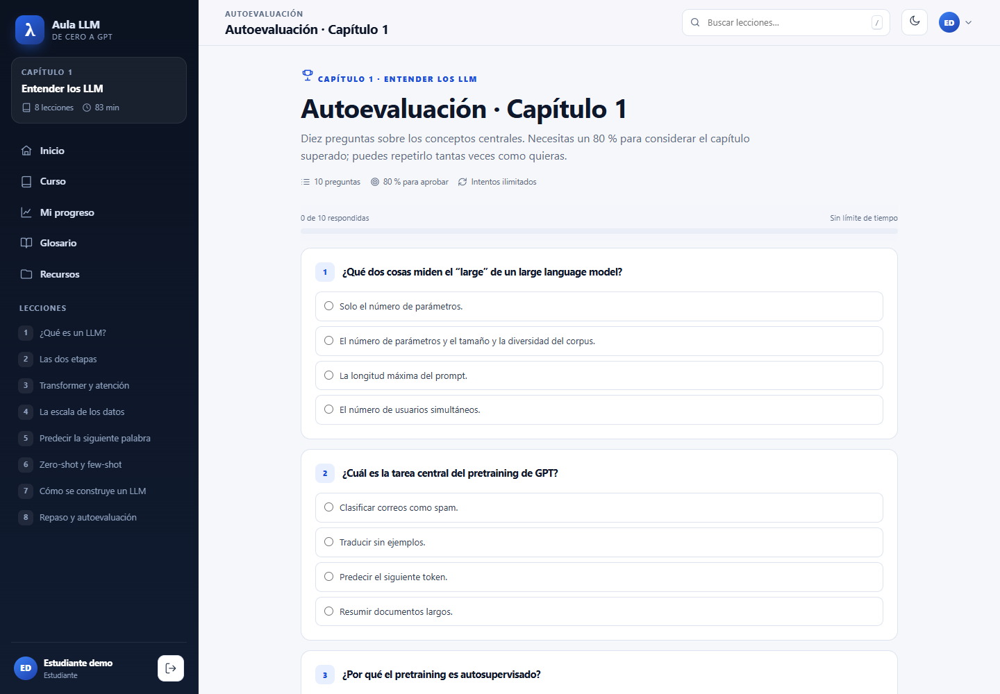

# SLAnything · Convierte cualquier material en un curso

Aula virtual web, bilingüe (español e inglés), que convierte **cualquier material
de aprendizaje** —apuntes, libros, manuales o artículos, de cualquier materia—
en cursos con lecciones guiadas, citas a la fuente, cuestionarios, glosario y
seguimiento del progreso. El **Estudio** lee el documento, propone un temario
editable y genera cada lección; tú revisas y decides qué se publica.

Funciona para dos tipos de cuenta:

- **Cuenta individual**: aprendes por tu cuenta y creas tus propias unidades.
- **Academia**: propietario y administración gestionan profesorado, alumnado,
  grupos, matrículas con fecha límite, invitaciones y analítica de clase. El
  profesorado crea unidades; el alumnado entra por invitación o código de clase
  y solo estudia.

Por encima, la **superadministración** gestiona usuarios, espacios, cuotas,
cursos abiertos y el proveedor de IA de toda la plataforma.

La interfaz es **Next.js 16 + React 19**; el backend es **FastAPI + SQLite** y la
generación usa un motor por etapas en el que cada paso es un **agente propio
construido con [nas-adk](https://github.com/marcosflz/nas-adk)**, con herramientas
validadas; cada persona puede usar su propia API key o su suscripción de Claude. La biblioteca empieza **vacía**: el repositorio incluye, como
**curso de ejemplo opcional**, «Construye un LLM desde cero» (basado en *Build a
Large Language Model (From Scratch)*), que se activa con `AULA_SAMPLE_COURSES=1`.

La web se puede instalar como **PWA** ([`docs/DESKTOP.md`](docs/DESKTOP.md)). Los
identificadores internos (`aula.db`, cookies `aula_*`, volumen `aula-llm-data`)
se mantienen por compatibilidad; el producto es SLAnything.



---

## Contexto para agentes

El repositorio mantiene una memoria persistente en formato **Open Knowledge
Format (OKF) v0.2**. Cualquier agente debe empezar por [`AGENTS.md`](AGENTS.md),
que enlaza el bundle [`okf/`](okf/index.md), y actualizarlo al terminar.

```powershell
uv run python tools/check_okf.py
```

---

## Aula web

### Arrancar

Requisitos: [uv](https://docs.astral.sh/uv/), Python 3.10 o superior, Node.js 20+ y npm.
No hace falta GPU.

```powershell
# Terminal 1 · backend FastAPI
uv sync
uv run python aula.py

# Terminal 2 · frontend Next.js
cd frontend
npm install
npm run dev
```

Abre <http://127.0.0.1:3000>. FastAPI (`:8000`) solo sirve la API.

Variables útiles en local:

```powershell
$env:AULA_SAMPLE_COURSES="1"   # muestra el curso de ejemplo LLM
$env:AULA_LLM_FAKE="1"         # Estudio sin red ni proveedor (modelo falso)
```

### Docker

El proyecto incluye `Dockerfile` para FastAPI, `frontend/Dockerfile` para Next y
`compose.yaml` para levantar ambos servicios:

```powershell
Copy-Item .env.example .env
# Cambia AULA_SECRET en .env
docker compose up -d --build
docker compose ps
```

Abrir <http://127.0.0.1:3000>. La base SQLite vive en el volumen
`aula-llm-data`; `docker compose down` la conserva y `down -v` la borra. Guía
completa: [`docs/DOCKER.md`](docs/DOCKER.md).

Cuentas sembradas (`AULA_SEED_DEMO=1`, una por perfil):

| Perfil | Correo | Contraseña |
|---|---|---|
| Alumno de la Academia Demo | `alumno@slanything.local` | `alumno1234` |
| Profesora y propietaria de la academia | `profe@slanything.local` | `profe1234` |
| Cuenta individual | `autodidacta@slanything.local` | `auto1234` |
| Superadmin de la plataforma | `admin@slanything.local` | `admin1234` |

El **registro es solo por invitación** (`AULA_OPEN_SIGNUP=0`, por defecto): la
superadministración invita a cuentas individuales y a profesorado (con academia
nueva o en una existente) desde `/plataforma/invitaciones`, y el profesorado
invita a su alumnado desde «Invitar alumnos». Con `AULA_OPEN_SIGNUP=1`,
`/registro` permite crear una cuenta individual, una academia o unirse con un
código de clase.

### Estudio de autoría

Entra con la cuenta individual o con la profesora y abre
<http://127.0.0.1:3000/estudio>.

1. La superadministración configura el proveedor de la plataforma en
   `/plataforma/ia` (OpenCode Go, OpenAI, Anthropic, OpenRouter, Gemini, DeepSeek,
   Ollama/LM Studio o un endpoint OpenAI-compatible). Cada persona que crea
   unidades puede usar el suyo en «Mi cuenta», incluida su suscripción personal de
   Claude (`claude setup-token`), que nunca se comparte. Sin red: `AULA_LLM_FAKE=1`.
2. Sube uno o varios documentos (PDF, DOCX, EPUB, ODT, Markdown, HTML o TXT),
   elige idiomas y qué secciones convertir.
3. Revisa y edita el temario, genera las lecciones y revisa la unidad: citas,
   cuestionario y glosario.
4. Publícala en tu espacio. En una academia, asígnala a un grupo con fecha
   límite desde `/admin/grupos`.

La API key se guarda en `authoring-data/settings.json` (0600) y nunca se
devuelve al navegador. El HTML generado se sanea y el contenido se valida antes
de entrar en la biblioteca. Guía: [`docs/AUTHORING.md`](docs/AUTHORING.md).

### Qué incluye

- **Perfiles y permisos**: cuenta individual, alumno, profesorado,
  administración de academia y superadmin, con una matriz de permisos única
  (`learn`, `author`, `teach`, `manage`, `platform`).
- **Biblioteca por espacio** (`/cursos`): cursos de tu espacio, cursos abiertos
  de la plataforma y, si se activan, de ejemplo. Los asignados por la academia
  aparecen primero con su fecha límite.
- **Estudio de autoría** por etapas: estructura del documento, temario editable,
  lecciones con citas «Fuente: p. N», preguntas de respuesta única, múltiple o
  verdadero/falso, glosario, verificación de respaldo y regeneración por lección.
- **Lecciones** con autocomprobaciones, apuntes privados, marcadores y progreso
  por curso; cuestionarios corregidos en el servidor con revisión razonada.
- **Analítica**: para cada persona, tiempo de estudio, racha, dominio por
  capítulo y preguntas a repasar; para el profesorado, embudo, mapa de calor,
  alumnado en riesgo y análisis de ítems; para la plataforma, uso global.
- **Academias**: miembros y roles, grupos, matrículas, código de clase,
  invitaciones de un solo uso y auditoría.
- **Curso de ejemplo opcional** (`AULA_SAMPLE_COURSES=1`): 7 capítulos y 56
  lecciones sobre LLM con 15 laboratorios interactivos y 26 ejemplos de Python
  ejecutables en servidor.
- Tema claro por defecto y oscuro opcional, responsive a 360 px y navegación por
  teclado.

### Capturas

| Portada | Registro por tipo de cuenta |
|---|---|
|  |  |

| Cuenta individual sin cursos | Alumno con curso asignado |
|---|---|
|  |  |

| Superadministración | Biblioteca con el curso de ejemplo |
|---|---|
|  |  |

**Curso de ejemplo** (capturas de la etapa anterior; la portada y el shell han
cambiado, el contenido del curso no):

| Lección | Laboratorio de n-gramas | Quiz |
|---|---|---|
|  |  |  |

La galería completa, con una descripción por archivo, está en
[`docs/capturas/`](docs/capturas/README.md).

### Estructura

```text
frontend/                 # interfaz Next.js 16 (App Router, React, TypeScript)
  src/app/                # rutas (incluye /estudio y manifest PWA)
  src/components/         # shell, bloques, laboratorios, quiz, Studio y UI
  src/lib/                # API, tipos, mensajes y cliente HTTP
  next.config.ts          # rewrites a FastAPI y cabeceras
  Dockerfile              # imagen standalone del frontend
Dockerfile                # imagen del backend FastAPI
compose.yaml              # backend + frontend + volumen SQLite
.env.example              # variables de Docker Compose
docs/DOCKER.md            # guía de imágenes, datos y despliegue
AGENTS.md                 # arranque de sesión y mantenimiento del OKF
okf/                      # bundle OKF: memoria persistente del proyecto
  index.md                # catálogo de conceptos
  log.md                  # historial newest-first
  context/                # playbook, glosario, problemas, siguientes pasos
  project/                # visión, estado y roadmap
  product/                # curso, lecciones, labs, quiz y UX
  architecture/           # backend, frontend, datos, seguridad y contenido
  operations/             # arranque, tests, despliegue y mapa
  decisions/              # ADRs
  references/             # fuentes y comandos
tools/
  check_okf.py            # validador de conformidad y enlaces
webapp/
  main.py                 # app FastAPI, middleware de idioma, errores
  db.py                   # SQLite, esquema y cuentas demo
  security.py             # scrypt, sesiones, CSRF, rate limit
  deps.py                 # autenticación y permisos
  repositories.py         # consultas SQL
  i18n.py                 # traducciones ES→EN de interfaz
  execution.py            # límites, rate limit y subproceso de ejecución
  sandbox_runner.py       # runner Python aislado (`python -I`)
  workspaces.py           # espacios, invitaciones y código de clase
  migrations.py           # migraciones versionadas (v4–v6)
  analytics.py            # eventos de aprendizaje y KPIs
  routers/                # api, authoring, admin, platform, analytics, workspaces, execution
  generation/             # motor de generación por etapas
  authoring/              # Estudio: proveedores, credenciales, extracción, contrato JSON y almacén
  content/                # curso de ejemplo (ES/EN) como módulos Python
  static/
    js/labs/              # 15 laboratorios del curso de ejemplo
    img/ch01..ch07/       # figuras del curso de ejemplo
    data/                 # corpus de El Quijote (curso de ejemplo)
  tests/                  # suite pytest
docs/
  PLAN_PLATAFORMA_WEB.md  # plan de acción e implementación
  CONTRATO_AGENTES.md     # contratos del agent swarm
  AUTHORING.md            # documentos → unidades con agentes nas-adk
  DESKTOP.md              # web + PWA y ruta a escritorio
  QA.md                   # estrategia y resultados de pruebas
notebooks/
  capitulo_01_entender_los_llms.ipynb   # cuaderno del curso de ejemplo
```

### Tests

```powershell
uv run python -m pytest -q
uv run python tools/check_okf.py

cd frontend
npm run typecheck
npm run build

# Con ambos servidores arrancados
uv run python tools/smoke_next.py          # --base para otra URL

# E2E de navegador (la primera vez: npx playwright install chromium)
npm run e2e                                # E2E_BASE para otra URL
npm run e2e:labs                           # 15 laboratorios; requiere AULA_SAMPLE_COURSES=1
```

La suite (211 tests) cubre perfiles y permisos, registro por invitación,
altas (individual, academia, código e invitación), biblioteca vacía, curso activo, aislamiento por espacio,
superadministración, matrículas, autenticación, CSRF, progreso, quiz, analítica,
generación por etapas con modelo falso, Estudio, ejecución Python, contenido del
curso de ejemplo y la API JSON. El smoke y el E2E recorren los cuatro perfiles
con y sin cursos de ejemplo.

### Producción mínima

```powershell
$env:AULA_ENV="production"
$env:AULA_SECRET="cambia-esto-por-un-secreto-largo"
$env:AULA_SECURE_COOKIES="1"
$env:AULA_DB="C:\datos\aula.db"
$env:AULA_EXEC_ENABLED="0"   # o mantén 1 con aislamiento adicional
uv run uvicorn webapp.main:app --host 127.0.0.1 --port 8000

# Frontend
cd frontend
$env:API_INTERNAL_URL="http://127.0.0.1:8000"
npm ci
npm run build
npm start
```

Pon un proxy inverso con TLS (Caddy o Nginx) delante de Next (puerto 3000),
desactiva la siembra demo (`AULA_SEED_DEMO=0`), define la superadministración
con `AULA_PLATFORM_ADMINS` y haz copias de seguridad de `aula.db`.
FastAPI puede quedar escuchando solo en loopback porque el navegador habla con
Next; los rewrites se encargan del resto.

La ejecución de Python corre en un subproceso con validación AST, hook de auditoría y
límites de tiempo, memoria, salida y concurrencia. Es defensa en profundidad, **no un
sandbox de nivel producción**: para exponer la app a Internet, ejecuta el runner en un
contenedor sin red y sin privilegios o desactívalo con `AULA_EXEC_ENABLED=0`. Variables
útiles: `AULA_EXEC_TIMEOUT`, `AULA_EXEC_MEMORY_MB`, `AULA_EXEC_CONCURRENT`,
`AULA_EXEC_RUNS_PER_MINUTE`.

---

## Curso de ejemplo y cuaderno

Con `AULA_SAMPLE_COURSES=1` la biblioteca incluye «Construye un LLM desde cero»
(7 capítulos, 56 lecciones, 15 laboratorios, 7 quizzes, 113 términos y 26
ejemplos de Python). Su cuaderno de Jupyter complementario:

```powershell
uv sync
uv run jupyter lab notebooks/capitulo_01_entender_los_llms.ipynb
```

---

## Créditos y licencias

Cada curso generado acredita la fuente en la que se basa; los derechos del
material original pertenecen a sus autores.

**Curso de ejemplo.** Es de **uso educativo personal**. Las figuras 1.1–1.9 provienen de
*Build a Large Language Model (From Scratch)* de Sebastian Raschka (Manning, 2024); todos
los derechos pertenecen a Manning Publications y al autor. No redistribuyas esas figuras
fuera de este contexto de estudio. Los diagramas `fig_es_*.png` son elaboración propia.

El fragmento de *Don Quijote* procede de [Project Gutenberg](https://www.gutenberg.org/ebooks/2000)
y es de dominio público. Se usa únicamente como corpus didáctico para el laboratorio de
n-gramas.

Las estimaciones de tokens, memoria y coste son aproximadas y de orden de magnitud; no
sustituyen una medición sobre hardware real.

El Estudio usa [nas-adk](https://github.com/marcosflz/nas-adk) para sus agentes y,
para la suscripción personal de Claude, el CLI oficial de
[Claude Code](https://claude.com/claude-code). Sus licencias, las condiciones de
Anthropic y las del proveedor LLM elegido son independientes de SLAnything.
